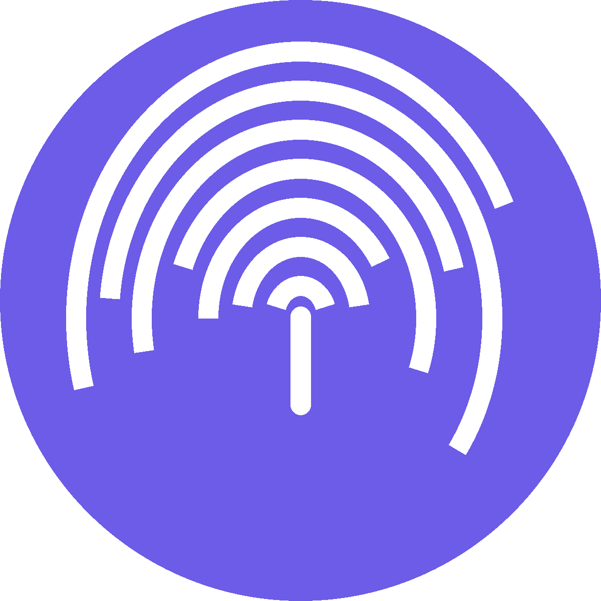
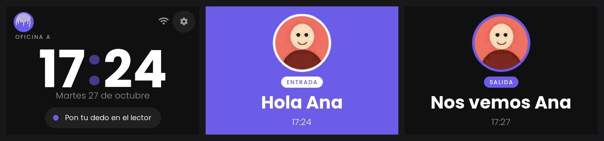
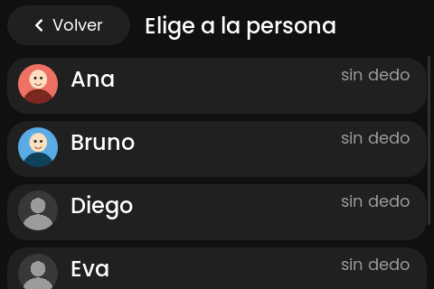
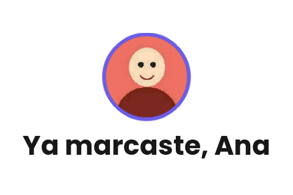
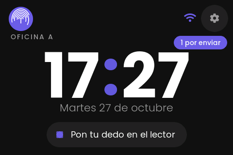
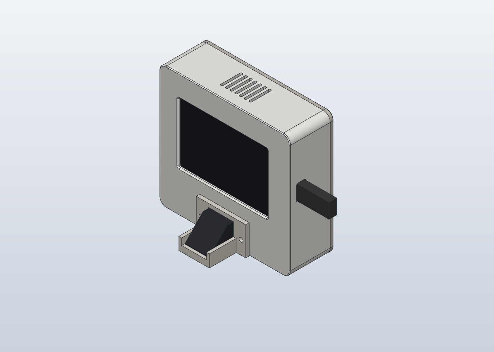

<p align="center">
  
</p>

<h1 align="center">Open Clock-In</h1>

<p align="center">
  An open-source fingerprint time clock: an ESP32-S3 touch screen, a cheap fingerprint sensor,<br>
  a 3D-printed case, and a tiny server you can connect to any database.
</p>

<p align="center">
  <a href="#quick-start">Quick start</a> ·
  <a href="docs/API.md">API</a> ·
  <a href="server/">Server</a> ·
  <a href="hardware/">Hardware &amp; 3D case</a> ·
  <a href="#para-agentes--for-ai-agents">For AI agents</a> ·
  <a href="#en-español">Español</a>
</p>

<p align="center">
  
</p>

People put a finger on the sensor and the screen greets them with their photo: **"Hola Ana"** when
they come in and **"Nos vemos Ana"** when they leave. Every punch goes to your server. If the
network is down, the clock still greets people and sends the punches later, in order.

## Features

- **One touch.** The server decides in or out from that person's punches of the day. A second
  touch within 2 minutes shows "Ya marcaste" (already punched) and is not counted.
- **Works offline.** Punches wait in a queue in flash and are retried with the same id, so the
  server never stores the same punch twice.
- **Several clocks, one list of people.** Enroll a finger on clock A and it works on clock B: the
  fingerprint template goes up to the server and the other clocks download it into their sensor.
  Each punch records which office it came from.
- **Photos.** Profile photos from the server (160×160 JPEG), cached on the clock.
- **Admin on the device.** PIN-protected menu to enroll and delete fingers, Wi-Fi setup on the touch
  screen, plus a small web page at `http://reloj.local` for the server address and key, status, and
  over-the-air updates.
- **Seasonal themes.** Christmas snow, New Year fireworks, confetti, little melodies, rotating
  greetings and hidden surprises (tap the clock 5 times). They are JSON files in [`temas/`](temas/).
- **HTTPS only**, with the certificate checked against the ESP-IDF root bundle. Keys live in the
  ESP32's NVS, never in the source.
- **PC simulator** (Windows) that runs the same UI and network code, with end-to-end tests.

| | | |
|---|---|---|
|  |  |  |
| Enroll: choose the person, place the finger twice | "Ya marcaste": a second touch within 2 min | Offline: "1 por enviar" (1 to send) |

<p align="center"></p>

## What you need

| | |
|---|---|
| Board | **LCDWiki / QDtech ES3C35P**: ESP32-S3, 3.5" 320×480 touch screen, speaker |
| Sensor | **AS608** optical fingerprint sensor (ZFM-20 protocol) |
| Case | 3 printed parts, PLA, no supports, about 86 g ([hardware/](hardware/)) |
| Server | anything that speaks [docs/API.md](docs/API.md); [server/server.py](server/) works out of the box |

Wiring, screws and print settings: [hardware/README.md](hardware/README.md).

## Quick start

**1. The server** (details in [server/README.md](server/README.md))

```sh
cd server
pip install pillow
export CLOCK_TOKEN="$(python -c 'import secrets; print(secrets.token_urlsafe(32))')"
python server.py add-person ana "Ana" --photo ana.jpg
python server.py serve --host 0.0.0.0 --port 8078
```

Put it behind HTTPS (Caddy, Cloudflare Tunnel, Railway, Fly.io…): the clock refuses plain HTTP.

**2. The firmware** ([PlatformIO](https://platformio.org/))

```sh
pio run -t upload        # board on USB-C
pio device monitor       # optional: serial log at 115200
```

**3. On the clock**

1. Gear icon → PIN **1234** → Ajustes → WiFi: pick your network.
2. From a computer on the same network open **http://reloj.local**. User `admin`, password = the
   PIN. Fill in the server address (`https://…`), the key (`CLOCK_TOKEN`) and the office (A/B).
3. Back on the clock: **Registrar dedo** → pick the person → finger twice.
4. **Change the PIN** (Ajustes → Cambiar clave). It is also the password of `reloj.local`.

Forgot the PIN? Hold the **BOOT** button for 10 seconds: it goes back to `PIN_INICIAL`.

Reports: `python server.py export-csv punches.csv --from 2026-10-01 --to 2026-10-31`.

## Customize

| What | Where |
|---|---|
| Accent color | `COLOR_ACENTO` in [`src/config.h`](src/config.h) (and `herramientas/dibujar_logo.py`) |
| Logo | replace `herramientas/logo.png`, run `python -I herramientas/logo.py` |
| Time zone | `ZONA_HORARIA` (POSIX TZ) in `src/config.h`; `CLOCK_TZ` on the server |
| Initial PIN | `PIN_INICIAL` in `src/config.h` |
| Themes | `temas/*.json` → `python -I herramientas/temas.py` (format in `src/tema.cpp`) |
| Language | the on-screen text is Spanish, in `src/ui.cpp` and `src/web_panel.h` |
| Database | rewrite the `Store` class in `server/server.py`, or build your own server from [docs/API.md](docs/API.md) |

## How it is built

- Arduino 2.0 on ESP-IDF 4.4 (PlatformIO `espressif32@6.6.0`), LVGL 9.2, ArduinoJson 7, Adafruit
  Fingerprint. The display driver (ST77922 over QSPI, rotated in software through a PSRAM framebuffer)
  is in `src/pantalla.cpp`.
- Core 0 runs the sensor task and the HTTPS task; core 1 runs the UI. Flash writes, which stall both
  cores, are kept away from animations.
- Code map and rules: [AGENTS.md](AGENTS.md).

### Simulator (Windows)

The simulator compiles the real `ui/datos/red/panel/fotos/tema.cpp` against fake Arduino, Wi-Fi,
sensor and flash layers. It opens a window for the screen and another one for the fake sensor. You need MinGW (e.g. the one in
Strawberry Perl), CMake and Ninja; run `pio run` once first so LVGL is downloaded.

```sh
cmake -G Ninja -S sim -B .sim/build && ninja -C .sim/build
python -I sim/probar_panel.py          # end-to-end test against sim/servidor_falso.py
python -I sim/probar_dos_oficinas.py   # two clocks sharing fingers
python -I sim/probar_panel.py http://127.0.0.1:8078 "$CLOCK_TOKEN"   # against your server
```

## Status

The firmware works in the simulator and both end-to-end suites pass, against the fake server and
against `server/server.py`. **It has not run on real hardware yet.** Before you trust it on a wall,
check:

- [ ] The image is upright with no stripes, and the touch matches the 4 corners
- [ ] The sensor is detected at 3.3 V (Información → "conectado"), and enroll and match work
- [ ] Template upload and download on a real AS608 (`[huella] sacar plantilla N: codigo 0, 512 bytes` on the serial monitor)
- [ ] HTTPS to your server; a punch while the router is off reaches the server once it is back
- [ ] OTA from `http://reloj.local`
- [ ] Animations stay smooth (the serial monitor prints the display load every 30 s)

Issues and pull requests are welcome, especially reports from real boards.

## Para agentes / for AI agents

Start with [AGENTS.md](AGENTS.md): code map, build and test commands, the rules that keep the clock
stable, and the definition of done. The server contract is [docs/API.md](docs/API.md).

## En español

Reloj control con huella, de código abierto. Cada persona pone el dedo y la pantalla la saluda con su
foto («Hola Ana» al entrar, «Nos vemos Ana» al salir). Las marcas se guardan en tu servidor, y sin
internet quedan en cola y se mandan después. Varios relojes comparten a las mismas personas: un dedo
registrado en uno sirve en los demás. La pantalla está en español.

- Piezas, conexiones y caja 3D: [hardware/](hardware/)
- Servidor con SQLite, fácil de cambiar a otra base: [server/](server/)
- Contrato reloj ↔ servidor: [docs/API.md](docs/API.md)
- Clave inicial **1234**. Cámbiala en Ajustes → Cambiar clave. Es la misma de `http://reloj.local`.

## License

Code: [MIT](LICENSE). 3D case (`hardware/`): [CC BY 4.0](hardware/LICENSE). Third-party parts:
[NOTICE.md](NOTICE.md).

Fingerprints are biometric data: check your local law, ask for consent, and keep your server private.
