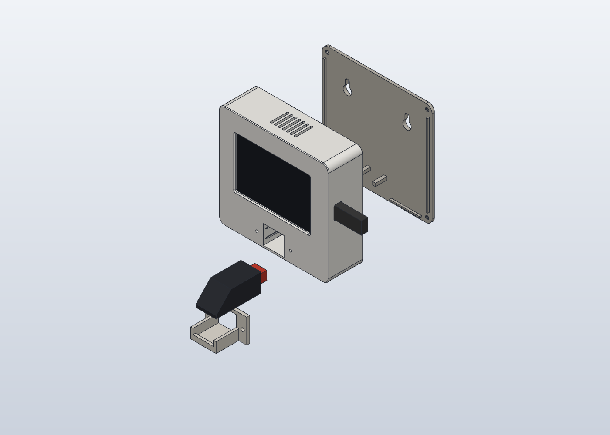
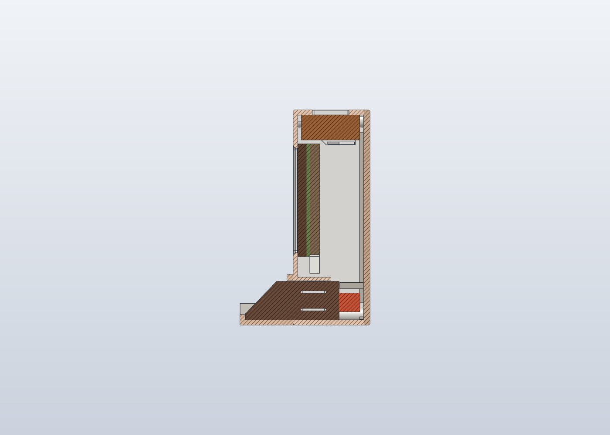

# Hardware



## Parts

| Part | Notes |
|---|---|
| **LCDWiki / QDtech ES3C35P** | 3.5" 320×480 IPS, capacitive touch. ESP32-S3R8 (16 MB flash, 8 MB PSRAM), ST77922 QSPI display, ES8311 audio codec + amplifier, RGB LED, USB-C. Sold on AliExpress as "ESP32-S3 3.5 inch display ES3C35P". Comes with a small speaker. |
| **AS608 fingerprint sensor** (ZFM-20 compatible) | 45.1 × 20.3 × 18.6 mm, UART, 3.3 V. Other ZFM-20 / R307 style sensors that speak the same protocol should work. |
| Cable, 1.25 mm JST | from the board's UART connector and its expansion connector (3.3 V) to the sensor |
| Screws | 4 × M3×10 (lid to front), 4 × M3×6 (display to posts; M3×8 goes through the front), 2 × M3×12 (shelf to front), 2 wall screws with plugs (head ≤ 8 mm) |
| Double-sided foam tape | for the speaker |
| USB-C power supply, 5 V 1 A | the clock stays plugged in |

## Wiring

| AS608 | ES3C35P |
|---|---|
| TX | **RXD** of the UART connector (GPIO44) |
| RX | **TXD** of the UART connector (GPIO43) |
| VCC (3.3 V) | 3.3 V pin of the expansion connector (not the 5 V of the UART connector) |
| GND | GND |

All pins are in [`src/config.h`](../src/config.h). Do not use IO45/IO46 for the sensor: they are
strapping pins and the sensor could stop the board from booting.

> **Status:** the firmware was developed and tested in the PC simulator, and the pinout comes from
> the official LCDWiki spec plus two other projects that use this board (xiaozhi-esp32 and
> NerdMiner). It has **not been run on a real board yet**. See the checklist in the main README.

## Case

Three parts that print without supports, made in SolidCraft (parametric CAD). Assembled size:
110 × 104 × 37 mm plus a 26 mm shelf for the sensor. The renders were checked for collisions with
models of the parts inside (display glass 0.2 mm clearance, sensor 0.3/0.4 mm, USB 0.46 mm).

| File | What it is |
|---|---|
| `case/stl/front.stl` | front: display window, sensor sleeve with crush ribs, speaker channel. Print face down |
| `case/stl/back-lid.stl` | back lid with keyholes for the wall and sensor stops |
| `case/stl/sensor-shelf.stl` | shelf that holds the sensor tilted towards the user |
| `case/stl/fit-test.stl` | the first 9 mm of the front: **print this first** to check the display and sensor fit (1 h, 30 g) |
| `case/step/*.step` | the same parts as STEP, to edit in any CAD |
| `case/print/*.gcode.3mf` | ready to print on a Bambu Lab A1 (PLA Basic, 0.20 mm, textured PEI 65 °C): case 2 h 32 min, 86 g; fit test 1 h, 30 g |
| `case/source/` | the SolidCraft model and the scripts that make it (see below) |



How each part is held:

- **Display**: 4 screws into posts. The screw guide leaves 2 mm of front unpierced (M3×6 max).
- **Sensor**: a sleeve with 6 crush ribs (0.15 mm interference), stops on the lid, and the shelf.
- **Speaker**: slides into a channel from the back; foam tape takes up the play.

### Remaking the case

`case/source/generar.py` holds every dimension at the top (display, sensor, walls, clearances). If
your parts measure differently, change the numbers and run:

```sh
cd hardware/case/source
export SOLIDCRAFT_CLI=/path/to/solidcraft-cli CASE_OUT=./out
python generar.py     # model + STEP/STL
python verificar.py   # collisions, clearances, closed meshes, overhangs -> "SIN PROBLEMAS"
python capturas.py    # renders
python laminar.py     # Bambu A1 slicing (BAMBU_STUDIO=/path/to/bambu-studio)
```

Python packages: `numpy`, `trimesh`, `manifold3d`. Comments in the scripts are in Spanish.

The dimensions come from the LCDWiki ES3C35P drawing (board 101.5 × 54.5 × 1.6, glass 83 × 54.5,
mounting holes Ø3.2 at 94.5 × 47.9; the visible area is offset 2.63 mm towards the MIC side) and the
AS608 seller's sheet. The speaker size (≤ 40 × 28 × 12) is an estimate.
